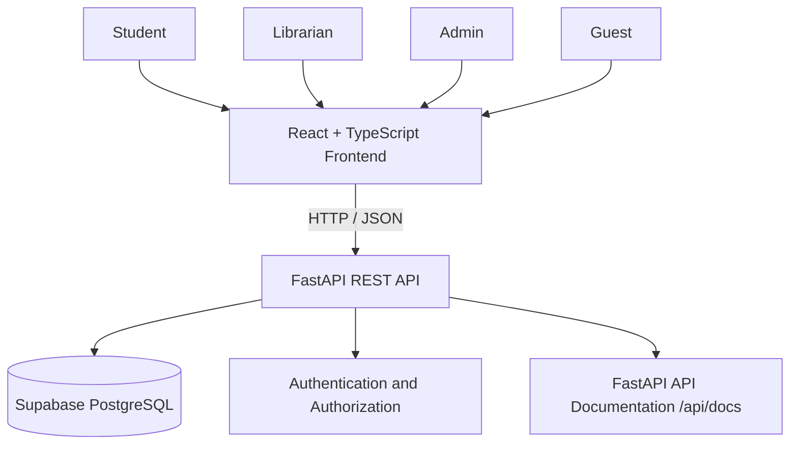
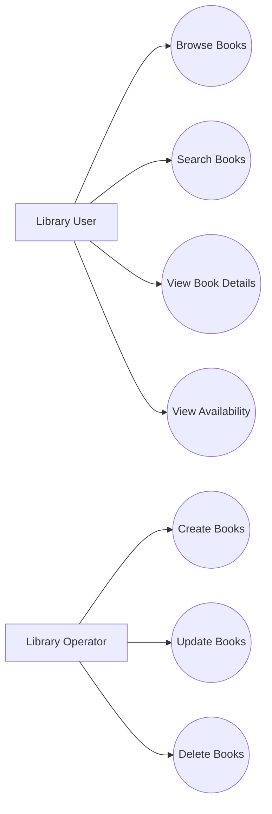
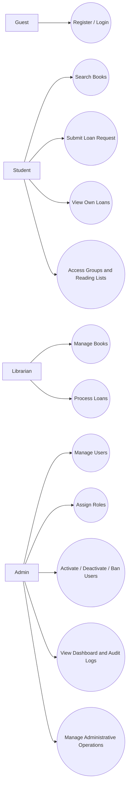
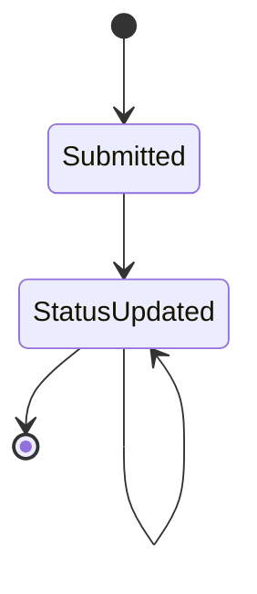

# LibraryNest — Software Requirements Specification (SRS)

| **Field** | **Value** |
|---|---|
| Product | LibraryNest |
| Version | MVP + Beta |
| Releases | MVP — Mid-term, Beta — Final |
| Status | Draft |
| Related docs | [Product Requirements Document (PRD)](01-prd.md), [Technical Design Document (TDD)](03-tdd.md) |

Every requirement has a **Release** column: **MVP** is built for the mid-term demonstration, and **Beta** adds authentication, role-based permissions, user management, loan management, groups, audit logging, and security for the final demonstration.

**Documents in this set**

| **Short form** | **Full form** | **Purpose** | **File** |
|---|---|---|---|
| PRD | Product Requirements Document | What we build and why | `docs/01-prd.md` |
| SRS | Software Requirements Specification | Exact requirements, permissions, and acceptance criteria | `docs/02-srs.md` |
| TDD | Technical Design Document | Architecture, database design, and API | `docs/03-tdd.md` |

## 1. Introduction

### 1.1 Purpose

This document specifies the requirements for LibraryNest: the MVP (book management, book search, and availability) and the Beta (user accounts, role-based permissions, loan management, user administration, groups, reading lists, audit logging, and security).

### 1.2 Scope

* **MVP:** Users can browse and search books, view book details and availability, and authorized library operators can create, update, and delete book records. The application stores data in Supabase PostgreSQL.
* **Beta:** Users can register and log in. Students can submit loan requests and access their own loan records. Librarians can manage books and process loans. Admins can manage users, roles, account status, and administrative operations. Users can also access group and reading-list features according to their permissions.
* **Out of scope:** Online payments, email notifications, advanced reservation queues, AI-based recommendations, and other features listed as out of scope in the [PRD, section 5](01-prd.md).

### 1.3 Definitions

| **Term** | **Meaning** |
|---|---|
| CRUD | Create, Read, Update, Delete |
| REST | An API style that uses HTTP methods to work with resources |
| Book | A library catalog record containing details such as title, author, ISBN, and availability |
| Loan | A record representing a book loan request and its status |
| Loan request | A request submitted by a user to borrow a book |
| Loan status | The current state of a loan request |
| REST API | An interface that allows the frontend or another client to communicate with the backend |
| RBAC | Role-Based Access Control: permissions depend on the authenticated user's role |
| Authentication | Verifying the identity of a user |
| Authorization | Checking whether an authenticated user is permitted to perform an action |
| Student | A registered user who searches for books and manages personal loan requests |
| Librarian | A user authorized to manage books and process loan operations |
| Admin | A user authorized to manage user accounts, roles, and administrative operations |
| Supabase PostgreSQL | The PostgreSQL database service used to store LibraryNest data |
| JWT | JSON Web Token used to identify authenticated API requests |
| Refresh token | A token used to obtain a new access token |
| Session | A user's authenticated login session |
| Group | A shared space in which members can access group-related features |
| Reading list | A collection of books maintained within a group |
| Audit log | A record of administrative or other tracked system activities |
| OpenAPI | A standard description of the API that FastAPI generates and exposes through its documentation interface |

## 2. Overall description

### 2.1 System context

LibraryNest consists of a React + TypeScript frontend, a FastAPI + Python backend, and a Supabase PostgreSQL database.

The frontend sends HTTP requests to the backend. The backend validates requests, applies business rules and permissions, and reads or updates records in Supabase PostgreSQL. In the Beta release, authentication and authorization are enforced by the backend. The backend also manages sessions, group permissions, and audit records.

### 2.2 Users and roles

| **Role** | **Release** | **Description** |
|---|---|---|
| Unauthenticated visitor | MVP | Can browse the catalog, search books, and view book details and availability. The MVP has no individual user accounts. |
| Library operator | MVP | Performs the core book-management operations for the demonstration. |
| Guest | Beta | Not logged in; can register, log in, and access public book browsing. |
| Student | Beta | Searches for books, views availability, submits loan requests, views personal loan records, and uses permitted group features. |
| Librarian | Beta | Manages book records and processes loan requests and returns. |
| Admin | Beta | Manages user accounts, assigns roles, controls account status, and accesses administrative features. |

In the Beta, `student`, `librarian`, and `admin` are global roles stored with each user account. Permissions are enforced by the backend, not only by hiding frontend buttons. Group-related permissions are also checked according to group ownership and membership permissions.

### 2.3 Use cases

**MVP**

**Beta**

An authenticated user can access only the operations permitted by their role and applicable resource permissions. An Admin manages user accounts and administrative operations; a Librarian manages library operations; a Student accesses personal loan records and permitted group features. Group owners and members can perform group operations according to the permissions enforced by the backend.

### 2.4 Constraints

* C-1: The frontend must use React with TypeScript.
* C-2: The backend must use Python with FastAPI.
* C-3: Supabase PostgreSQL is the database for both releases.
* C-4: The frontend and backend communicate through REST APIs using JSON.
* C-5: The backend must validate input and return appropriate HTTP status codes.
* C-6: In the Beta, authentication and permission checks must be implemented on the server.
* C-7: API endpoints and request/response schemas must be documented through FastAPI's `/api/docs` interface.
* C-8: The deployment environment must support the frontend, backend, and database connection.
* C-9: Authentication secrets and database credentials must be supplied through environment configuration.
* C-10: Group ownership and membership permissions must be enforced by the backend.

### 2.5 Assumptions

* A-1: A working Supabase PostgreSQL database is available to the application.
* A-2: The application is primarily intended for a university library demonstration and a limited number of users.
* A-3: In the MVP, the demonstration does not require individual user accounts.
* A-4: In the Beta, an initial Admin account can be configured through a controlled setup process.
* A-5: Book availability is maintained using the book's recorded copy information and applicable loan activity.
* A-6: Loan policies, such as loan duration and borrowing limits, remain subject to the implemented application rules.
* A-7: Authenticated users must have valid access credentials to use protected endpoints.
* A-8: Group operations depend on group ownership, membership, and assigned permissions.

## 3. Functional requirements

### 3.1 Book management — MVP

| **ID** | **Requirement** | **Release** | **Story** |
|---|---|---|---|
| FR-01 | The system shall create a book record from a valid JSON request containing the required book information. | MVP | US-01 |
| FR-02 | The system shall return a list of book records. | MVP | US-02 |
| FR-03 | The system shall return one book record by its ID. | MVP | US-02 |
| FR-04 | The system shall update supported fields of an existing book record through the book update endpoint. | MVP | US-03 |
| FR-05 | The system shall delete an existing book record when the deletion is permitted by applicable data constraints. | MVP | US-03 |
| FR-06 | The system shall reject invalid book input with an appropriate validation error response. | MVP | US-09 |
| FR-07 | The system shall return `404 Not Found` when a requested book ID does not exist. | MVP | US-09 |
| FR-08 | The system shall store book records in Supabase PostgreSQL so that data persists after an application restart. | MVP | US-01, US-02 |
| FR-09 | The system shall expose book creation, listing, retrieval, update, and deletion through REST API endpoints. | MVP | US-01, US-02, US-03 |

### 3.2 Book search and availability — MVP

| **ID** | **Requirement** | **Release** | **Story** |
|---|---|---|---|
| FR-10 | The system shall allow book searches by title. | MVP | US-04 |
| FR-11 | The system shall allow book searches by author. | MVP | US-04 |
| FR-12 | The system shall allow book searches by ISBN. | MVP | US-04 |
| FR-13 | The system shall return book details and available copy information when supported by the stored book record. | MVP | US-05 |
| FR-14 | The system shall return an empty result set when no books match a valid search query. | MVP | US-04 |
| FR-15 | The system shall validate search parameters and return a clear error for invalid input. | MVP | US-09 |

### 3.3 Loan management — Beta

| **ID** | **Requirement** | **Release** | **Story** |
|---|---|---|---|
| FR-16 | The system shall allow an authenticated user to submit a loan request for an existing book. | Beta | US-06 |
| FR-17 | The system shall assign the initial status to a newly submitted loan request according to the implemented loan workflow. | Beta | US-06 |
| FR-18 | The system shall return loan request records and their current statuses according to the caller's permissions. | Beta | US-07 |
| FR-19 | The system shall allow an authorized user to update a loan request's status through the loan status endpoint. | Beta | US-08 |
| FR-20 | The system shall support recording loan returns through the implemented loan status workflow. | Beta | US-08 |
| FR-21 | The system shall reject invalid loan requests or invalid status changes with an appropriate error response. | Beta | US-09 |
| FR-22 | The system shall store loan requests and status changes in Supabase PostgreSQL. | Beta | US-06, US-07, US-08 |
| FR-23 | The system shall maintain consistent loan and book availability information when loan statuses are updated. | Beta | US-05, US-08 |

### 3.4 Authentication and profile — Beta

| **ID** | **Requirement** | **Release** | **Story** |
|---|---|---|---|
| FR-24 | The system shall allow a guest to register a new user account with the required registration information. | Beta | US-10 |
| FR-25 | The system shall allow a registered user to log in with valid credentials. Invalid credentials shall return `401 Unauthorized`. | Beta | US-11 |
| FR-26 | The system shall identify authenticated requests using JWT access tokens. | Beta | US-11 |
| FR-27 | The system shall allow an authenticated user to access loan records according to the user's permissions and ownership. | Beta | US-12 |
| FR-28 | The system shall never return a user's password or password hash in API responses. | Beta | US-17 |
| FR-29 | The system shall reject protected requests without valid authentication using `401 Unauthorized`. | Beta | US-15 |
| FR-30 | The system shall allow a user to view and update their own profile information. | Beta | US-12 |
| FR-31 | The system shall support refresh-token operations for maintaining authenticated sessions. | Beta | US-11 |
| FR-32 | The system shall allow an authenticated user to log out through the authentication API. | Beta | US-11 |
| FR-33 | The system shall allow a user to change their password through the password-change operation. | Beta | US-12 |
| FR-34 | The system shall allow a user to view their active sessions and revoke an individual session. | Beta | US-12 |

### 3.5 Roles and user management — Beta

| **ID** | **Requirement** | **Release** | **Story** |
|---|---|---|---|
| FR-35 | Every registered user shall have one global role: `student`, `librarian`, or `admin`. | Beta | US-15 |
| FR-36 | The system shall restrict book-management operations to authorized roles according to the backend permission rules. | Beta | US-13, US-15 |
| FR-37 | The system shall restrict loan operations according to the backend authorization rules. | Beta | US-13, US-15 |
| FR-38 | An Admin shall be able to list registered user accounts. | Beta | US-14 |
| FR-39 | An Admin shall be able to view an individual user's details. | Beta | US-14 |
| FR-40 | An Admin shall be able to assign or update a user's role. | Beta | US-14 |
| FR-41 | An Admin shall be able to activate or deactivate a user account. | Beta | US-16 |
| FR-42 | An Admin shall be able to ban or unban a user account. | Beta | US-16 |
| FR-43 | The system shall prevent inactive or banned users from accessing protected endpoints. | Beta | US-16, US-17 |
| FR-44 | The system shall allow an Admin to perform supported bulk user-management actions. | Beta | US-14 |
| FR-45 | The system shall provide administrative dashboard statistics through the user-management API. | Beta | US-14 |
| FR-46 | A non-Admin user calling an Admin-only endpoint shall receive `403 Forbidden`. | Beta | US-14, US-15 |
| FR-47 | An Admin shall be able to revoke a user's sessions through the user-management API. | Beta | US-16 |

### 3.6 Groups, reading lists, and audit — Beta

| **ID** | **Requirement** | **Release** | **Story** |
|---|---|---|---|
| FR-48 | The system shall allow authorized users to create and view groups. | Beta | US-18 |
| FR-49 | The system shall allow group owners to update or delete their groups according to ownership rules. | Beta | US-18 |
| FR-50 | The system shall allow users to view group details and member information when permitted. | Beta | US-18 |
| FR-51 | The system shall allow authorized group owners to add and remove group members. | Beta | US-19 |
| FR-52 | The system shall allow group owners to update member permissions through the group permission operation. | Beta | US-19 |
| FR-53 | The system shall enforce group ownership and membership permissions when users access group operations. | Beta | US-19 |
| FR-54 | The system shall allow authorized group members to access the group's reading list. | Beta | US-20 |
| FR-55 | The system shall allow permitted users to add, update, and remove reading-list items. | Beta | US-20 |
| FR-56 | The system shall record tracked system activities as audit log entries. | Beta | US-21 |
| FR-57 | The system shall allow authorized administrators to retrieve and filter audit log records. | Beta | US-21 |

### 3.7 Security and API behavior — Beta

| **ID** | **Requirement** | **Release** | **Story** |
|---|---|---|---|
| FR-58 | The system shall store passwords using a suitable password-hashing algorithm rather than plain text. | Beta | US-17 |
| FR-59 | The system shall validate user input on the backend before processing operations. | MVP / Beta | US-09, US-17 |
| FR-60 | The system shall keep database credentials and authentication secrets in environment configuration rather than source code. | Beta | US-17 |
| FR-61 | The system shall return consistent error responses without exposing stack traces, password data, or database credentials. | Beta | US-17 |
| FR-62 | The system shall verify the authenticated user's current account status and role when processing protected requests. | Beta | US-15, US-17 |
| FR-63 | The system shall enforce session and token validity according to the implemented authentication workflow. | Beta | US-11, US-17 |
| FR-64 | The system shall record applicable administrative actions and their outcomes in the audit log. | Beta | US-21 |

### 3.8 Validation rules

| **Field** | **Rule** | **Release** |
|---|---|---|
| Book fields | Must satisfy the backend book request schema | MVP |
| `book_id` | Must refer to an existing book | MVP |
| Search parameters | Must satisfy the backend search parameter validation | MVP |
| `loan_id` | Must refer to an existing loan request | Beta |
| Loan status | Must be accepted by the implemented loan status workflow | Beta |
| Registration fields | Must satisfy the backend registration schema | Beta |
| `email` | Must satisfy email validation and account uniqueness rules | Beta |
| `password` | Must satisfy the application's password validation rules | Beta |
| `role` | One of `student`, `librarian`, or `admin` | Beta |
| Account status | Must satisfy the implemented account activation/deactivation rules | Beta |
| Ban status | Must satisfy the implemented ban/unban rules | Beta |
| Group membership | The user must satisfy the applicable group ownership or membership rules | Beta |
| Group permissions | Must match the supported permission fields and authorization rules | Beta |
| Reading-list item | Must refer to a valid group and supported item information | Beta |

### 3.9 Loan states

A loan request is created through the loan creation endpoint. Authorized users can update its status through the loan status endpoint. The backend validates status changes and applies the relevant business rules. Exact accepted status values and transitions are determined by the implemented loan workflow.

### 3.10 Permission matrix — Beta

| **Action** | **Guest** | **Student** | **Librarian** | **Admin** |
|---|---|---|---|---|
| Register and log in | Yes | — | — | — |
| Browse and search books | Yes | Yes | Yes | Yes |
| View book details and availability | Yes | Yes | Yes | Yes |
| Create book records | No | No (`403`) | According to backend authorization | According to backend authorization |
| Update book records | No | No (`403`) | According to backend authorization | According to backend authorization |
| Delete book records | No | No (`403`) | According to backend authorization | According to backend authorization |
| Submit a loan request | No | According to backend authorization | According to backend authorization | According to backend authorization |
| View personal loan records | No | Own records | According to backend authorization | According to backend authorization |
| View loan records | No | According to backend authorization | According to backend authorization | According to backend authorization |
| Update loan status | No | No (`403`) | According to backend authorization | According to backend authorization |
| View and update own profile | No | Yes | Yes | Yes |
| Change own password | No | Yes | Yes | Yes |
| View and revoke own sessions | No | Yes | Yes | Yes |
| List user accounts | No | No (`403`) | No (`403`) | Yes |
| View user details | No | No (`403`) | No (`403`) | Yes |
| Assign or change roles | No | No (`403`) | No (`403`) | Yes |
| Activate or deactivate accounts | No | No (`403`) | No (`403`) | Yes |
| Ban or unban users | No | No (`403`) | No (`403`) | Yes |
| Perform bulk user actions | No | No (`403`) | No (`403`) | Yes |
| View administrative dashboard statistics | No | No (`403`) | No (`403`) | Yes |
| Revoke another user's sessions | No | No (`403`) | No (`403`) | Yes |
| Create and manage groups | No | According to group permissions | According to group permissions | According to group permissions |
| Manage group members and permissions | No | Owner/permission dependent | Owner/permission dependent | According to backend authorization |
| Access group reading lists | No | Membership/permission dependent | Membership/permission dependent | According to backend authorization |
| View audit logs | No | No (`403`) | No (`403`) | Yes |
| Access protected APIs while inactive or banned | No | No (`401`) | No (`401`) | No (`401`) |

In this matrix, “Yes” means the action is permitted subject to valid input and applicable business rules. “According to backend authorization” means access is determined by the implemented role, ownership, membership, or permission checks. Group permissions are not determined solely by the user's global role.

### 3.11 Status codes

| **Case** | **Code** | **Release** |
|---|---|---|
| Resource created | `201 Created` | MVP / Beta |
| Resource retrieved or updated | `200 OK` | MVP / Beta |
| Resource deleted successfully | `204 No Content` | MVP / Beta |
| Invalid request data | `422 Unprocessable Entity` | MVP / Beta |
| Resource not found | `404 Not Found` | MVP / Beta |
| Unexpected server error | `500 Internal Server Error` | MVP / Beta |
| Missing or invalid credentials | `401 Unauthorized` | Beta |
| Authenticated user lacks permission | `403 Forbidden` | Beta |
| Duplicate account information or conflicting resource | `409 Conflict` where applicable | MVP / Beta |
| Invalid operation or status change | Appropriate client error response | MVP / Beta |

## 4. Non-functional requirements

| **ID** | **Category** | **Requirement** | **Release** |
|---|---|---|---|
| NFR-01 | Performance | Book search shall return results within 2 seconds under normal testing conditions. | MVP |
| NFR-02 | Persistence | Book records shall persist in Supabase PostgreSQL after application restarts. | MVP |
| NFR-03 | Reliability | The API shall return valid responses for supported requests and clear errors for invalid requests. | MVP |
| NFR-04 | Usability (API) | FastAPI shall expose interactive API documentation at `/api/docs`. | MVP |
| NFR-05 | Maintainability | Backend code shall separate API routes, validation schemas, database access, and business logic appropriately. | MVP / Beta |
| NFR-06 | Security | Database credentials shall not be committed to the Git repository. | MVP / Beta |
| NFR-07 | Security | Database operations shall use safe ORM or parameterized database operations. | MVP / Beta |
| NFR-08 | Compatibility | The frontend shall use React + TypeScript and communicate with the FastAPI backend through REST APIs. | MVP / Beta |
| NFR-09 | Security | Passwords shall be securely hashed and never stored or returned in plain text. | Beta |
| NFR-10 | Security | Protected API endpoints shall enforce authentication and role permissions on the server. | Beta |
| NFR-11 | Security | Inactive or banned users shall be denied access to protected operations. | Beta |
| NFR-12 | Security | Secrets and credentials shall be supplied through environment variables or an equivalent secure configuration mechanism. | Beta |
| NFR-13 | Privacy | Students shall not be able to access another student's private loan records without authorization. | Beta |
| NFR-14 | Reliability | Loan status updates and relevant book availability changes shall remain consistent. | Beta |
| NFR-15 | Maintainability | Database schema changes shall be documented and applied consistently across development environments. | MVP / Beta |
| NFR-16 | Deployability | The integrated application shall run in the environment selected for the demonstration. | Beta |
| NFR-17 | Security | Group ownership, membership, and permissions shall be checked on the backend. | Beta |
| NFR-18 | Auditability | Applicable administrative actions shall be recorded with relevant actor, target, event, and outcome information. | Beta |
| NFR-19 | Session management | The system shall support session revocation and enforce authentication validity on protected requests. | Beta |

## 5. Acceptance criteria

### MVP

**AC-01 Create book (FR-01, FR-08)**

* Given valid book details.
* When a client sends a book creation request.
* Then the system returns the created book record and stores it in Supabase PostgreSQL.

**AC-02 Reject invalid book (FR-06)**

* Given a request containing invalid or missing required book information.
* When the client submits the request.
* Then the system returns a validation error identifying the invalid input.

**AC-03 List and view books (FR-02, FR-03, FR-07)**

* Given that book records exist.
* When the client requests the book list or an existing book by ID.
* Then the system returns the relevant records.
* When the requested book ID does not exist.
* Then the system returns `404 Not Found`.

**AC-04 Update book (FR-04)**

* Given an existing book record.
* When a client sends a valid update request.
* Then the system saves the supported changes.

**AC-05 Delete book (FR-05)**

* Given an existing book that can be deleted without violating applicable data constraints.
* When the client sends a delete request.
* Then the system deletes the book record and subsequent retrieval requests no longer return it.

**AC-06 Search books (FR-10–FR-15)**

* Given books with known titles, authors, and ISBNs.
* When a client searches by one of these fields.
* Then the system returns matching records and available book information.
* When no records match, the system returns an empty result set.

**AC-07 API documentation**

* When a developer opens `/api/docs`.
* Then the documented endpoints, request schemas, and response schemas are available for inspection.

### Beta

**AC-08 Register account (FR-24)**

* Given that a user account does not already exist for the submitted registration information.
* When a guest submits valid registration details.
* Then the system creates the user account with the applicable default role.

**AC-09 Login and authentication (FR-25, FR-26, FR-29, FR-31)**

* Given a registered and active user.
* When the user submits valid credentials.
* Then the system authenticates the user and provides the required authentication tokens.
* When the credentials are invalid.
* Then the system returns `401 Unauthorized`.

**AC-10 Authentication required (FR-29)**

* When a guest requests a protected endpoint.
* Then the system returns `401 Unauthorized`.

**AC-11 Role-restricted operations (FR-35–FR-37, FR-46)**

* Given users with different global roles.
* When a user attempts an operation that is not permitted by the backend authorization rules.
* Then the system rejects the operation with `403 Forbidden`.

**AC-12 Process loans (FR-16–FR-23)**

* Given an authenticated user and an existing book.
* When the user submits a valid loan request.
* Then the system creates and stores the loan request.
* When an authorized user updates the loan status.
* Then the system validates the status change and stores the updated record.

**AC-13 Personal loan privacy (FR-27)**

* Given two different student accounts with separate loan records.
* When one student requests their personal loan records.
* Then the response contains only the records that the student is authorized to access.

**AC-14 Admin-only user management (FR-38, FR-39, FR-46)**

* When a Student or Librarian calls an Admin-only user-management endpoint.
* Then the system returns `403 Forbidden`.
* When an Admin makes a valid request.
* Then the system returns the requested user information.

**AC-15 Role assignment (FR-40)**

* Given an existing user account.
* When an Admin changes the user's role to a supported role.
* Then the system stores the new role and applies the updated authorization rules on subsequent requests.

**AC-16 Account status and ban management (FR-41–FR-43)**

* Given an existing user account.
* When an Admin activates, deactivates, bans, or unbans the account.
* Then the system updates the account state.
* When an inactive or banned user attempts to access a protected endpoint.
* Then the system denies access.

**AC-17 Session management (FR-31–FR-34, FR-47)**

* Given an authenticated user with an active session.
* When the user views or revokes their own session.
* Then the system processes the request according to session ownership.
* When an Admin revokes another user's sessions.
* Then the system applies the session revocation.

**AC-18 Password protection (FR-28, FR-58)**

* Given a registered user.
* When the account is created and later retrieved through an API.
* Then the stored password is hashed, and no password or password hash is returned in the response.

**AC-19 Groups and member permissions (FR-48–FR-53)**

* Given a group with an owner and members.
* When an authorized owner manages the group or its members.
* Then the system applies the requested operation according to group ownership and permission rules.
* When a user attempts an unauthorized group operation.
* Then the system rejects the operation.

**AC-20 Reading lists (FR-54, FR-55)**

* Given a group with an accessible reading list.
* When a permitted member views or updates a reading-list item.
* Then the system returns or updates the item according to the member's permissions.

**AC-21 Audit logs (FR-56, FR-57, FR-64)**

* Given an applicable tracked system activity.
* When the activity is performed.
* Then the system records the relevant audit information.
* When an authorized administrator requests audit records.
* Then the system returns the records according to the supported filters and pagination.

**AC-22 Dashboard and bulk user actions (FR-44, FR-45)**

* Given an Admin account.
* When the Admin requests dashboard statistics or performs a supported bulk user action.
* Then the system returns the applicable statistics or processes the requested action.

**AC-23 Error handling and secure configuration (FR-59–FR-63)**

* Given an invalid request or an unexpected backend error.
* When the API processes the request.
* Then it returns an appropriate error response without exposing secrets, password data, database credentials, or internal stack traces.

### General

**AC-24 Deployment**

* Given the deployed frontend, backend, and database configuration.
* When a user accesses the deployed application.
* Then the frontend can communicate with the backend and the backend can access the configured database.

## 6. Traceability

| **Story** | **Requirements** | **Endpoint (see TDD, REST API design)** | **Release** |
|---|---|---|---|
| US-01 | FR-01, FR-08, FR-09 | `POST /api/books/` | MVP |
| US-02 | FR-02, FR-03, FR-07, FR-09 | `GET /api/books/`, `GET /api/books/{book_id}` | MVP |
| US-03 | FR-04, FR-05 | `PUT /api/books/{book_id}`, `DELETE /api/books/{book_id}` | MVP |
| US-04 | FR-10–FR-12, FR-14 | `GET /api/books/` | MVP |
| US-05 | FR-13, FR-23 | `GET /api/books/`, `GET /api/books/{book_id}` | MVP / Beta |
| US-06 | FR-16, FR-17, FR-22 | `POST /api/loans/` | Beta |
| US-07 | FR-18, FR-22 | `GET /api/loans/`, `GET /api/loans/{loan_id}` | Beta |
| US-08 | FR-19–FR-23 | `PATCH /api/loans/{loan_id}/status` | Beta |
| US-09 | FR-06, FR-07, FR-15, FR-21 | Relevant endpoints, `/api/docs` | MVP / Beta |
| US-10 | FR-24 | `POST /api/auth/register` | Beta |
| US-11 | FR-25, FR-26, FR-29, FR-31, FR-32 | `POST /api/auth/login`, `POST /api/auth/refresh`, `POST /api/auth/logout` | Beta |
| US-12 | FR-27, FR-30, FR-33, FR-34 | `GET /api/auth/me`, `PATCH /api/auth/me`, `POST /api/auth/change-password`, `GET /api/auth/me/sessions`, `DELETE /api/auth/me/sessions/{session_id}` | Beta |
| US-13 | FR-36, FR-37 | `/api/books/`, `/api/loans/` | Beta |
| US-14 | FR-38–FR-40, FR-44–FR-46 | `GET /api/users/`, `GET /api/users/{user_id}`, `PATCH /api/users/{user_id}/role`, `POST /api/users/bulk-action`, `GET /api/users/admin/dashboard-stats` | Beta |
| US-15 | FR-35–FR-37, FR-46, FR-59, FR-62 | Protected endpoints and role authorization | Beta |
| US-16 | FR-41–FR-43, FR-47 | `PATCH /api/users/{user_id}/activate`, `PATCH /api/users/{user_id}/deactivate`, `POST /api/users/{user_id}/ban`, `PATCH /api/users/{user_id}/unban`, `POST /api/users/{user_id}/sessions/revoke` | Beta |
| US-17 | FR-28, FR-58–FR-63 | Authentication, user, and protected endpoints | Beta |
| US-18 | FR-48–FR-50 | `GET /api/groups`, `POST /api/groups`, `GET /api/groups/{group_id}`, `PATCH /api/groups/{group_id}`, `DELETE /api/groups/{group_id}` | Beta |
| US-19 | FR-51–FR-53 | `/api/groups/{group_id}/members` and related member permission endpoints | Beta |
| US-20 | FR-54, FR-55 | `/api/groups/{group_id}/reading-list` and related reading-list item endpoints | Beta |
| US-21 | FR-56, FR-57, FR-64 | `GET /api/audit/` | Beta |
| US-22 | FR-44, FR-45 | `POST /api/users/bulk-action`, `GET /api/users/admin/dashboard-stats` | Beta |
| US-23 | FR-31–FR-34, FR-47 | Authentication session and user session endpoints | Beta |
| US-24 | FR-59–FR-63 | Relevant API endpoints and protected operations | Beta |
