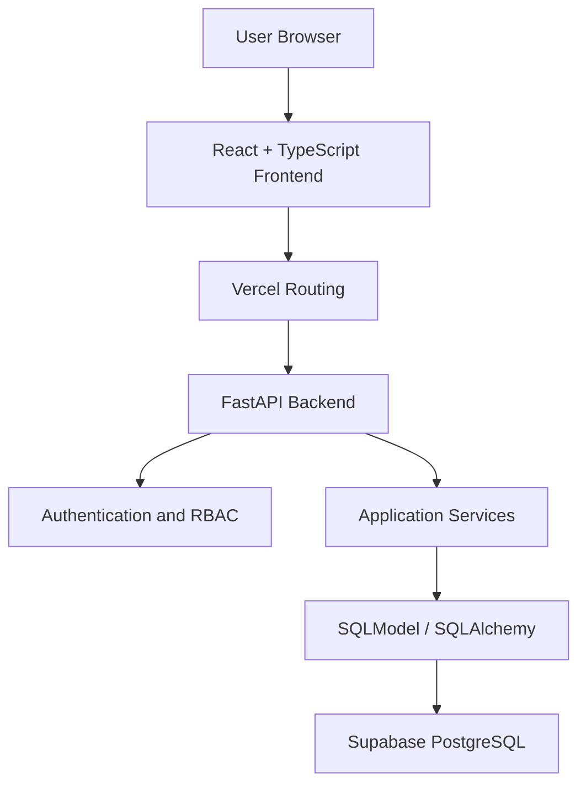
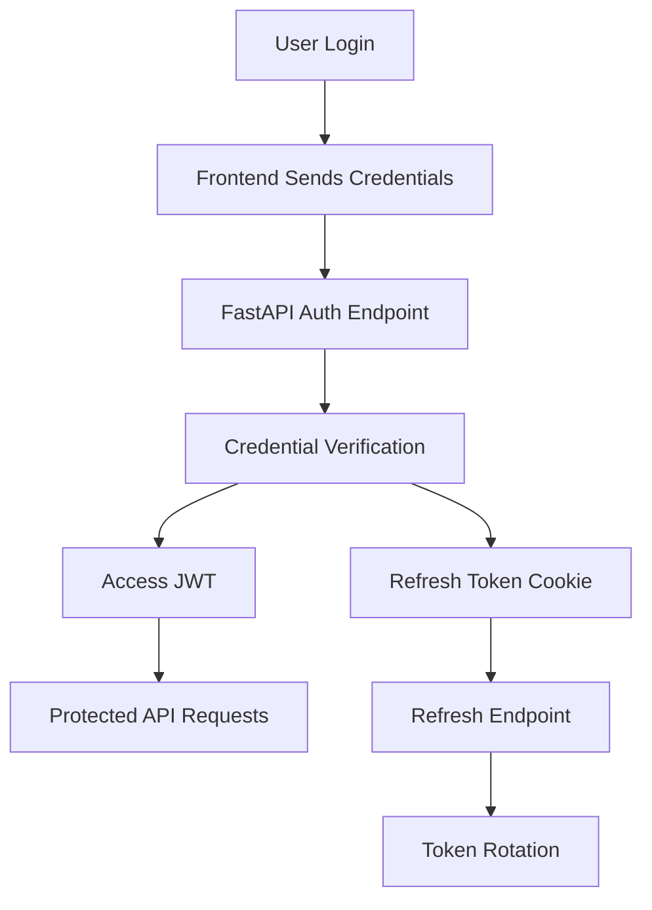
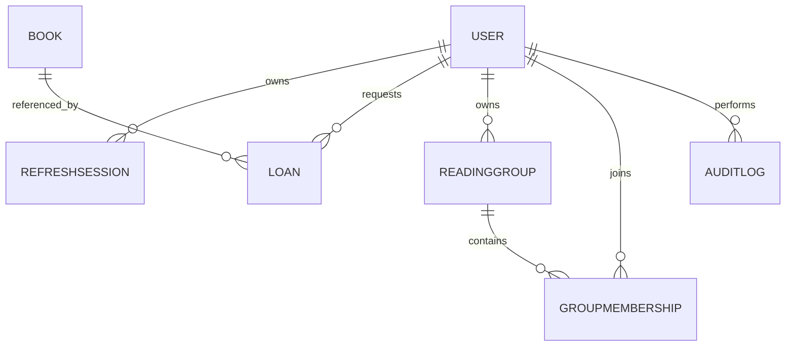
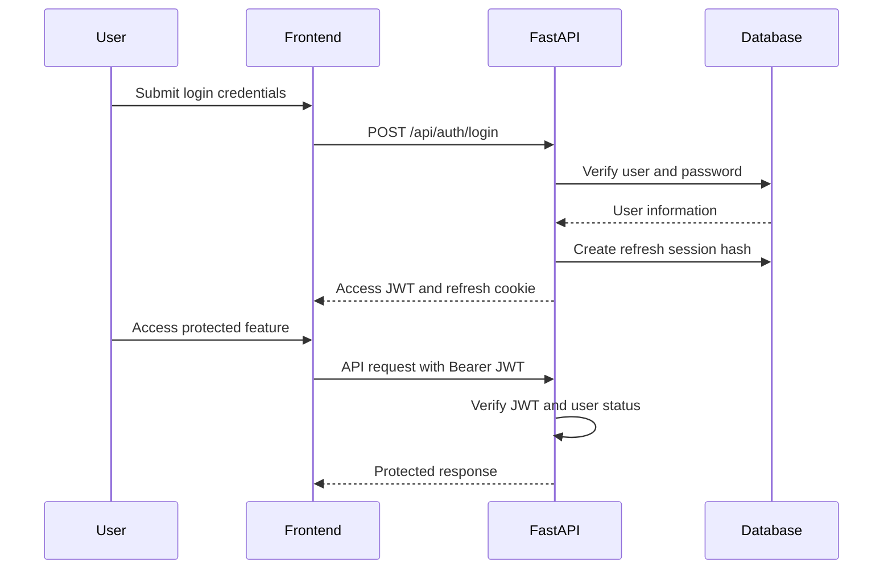
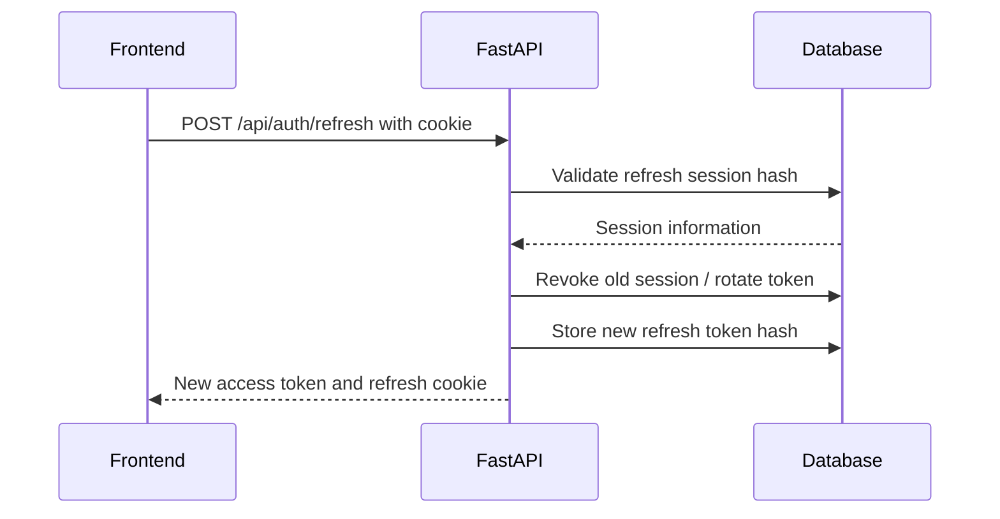
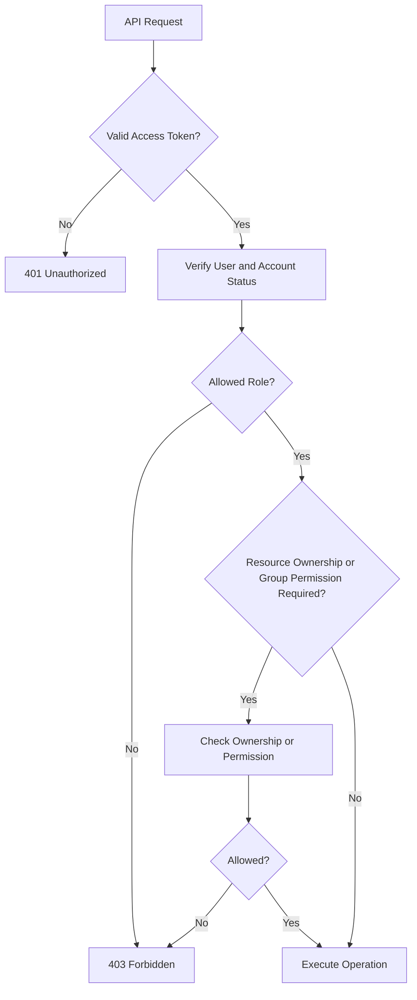
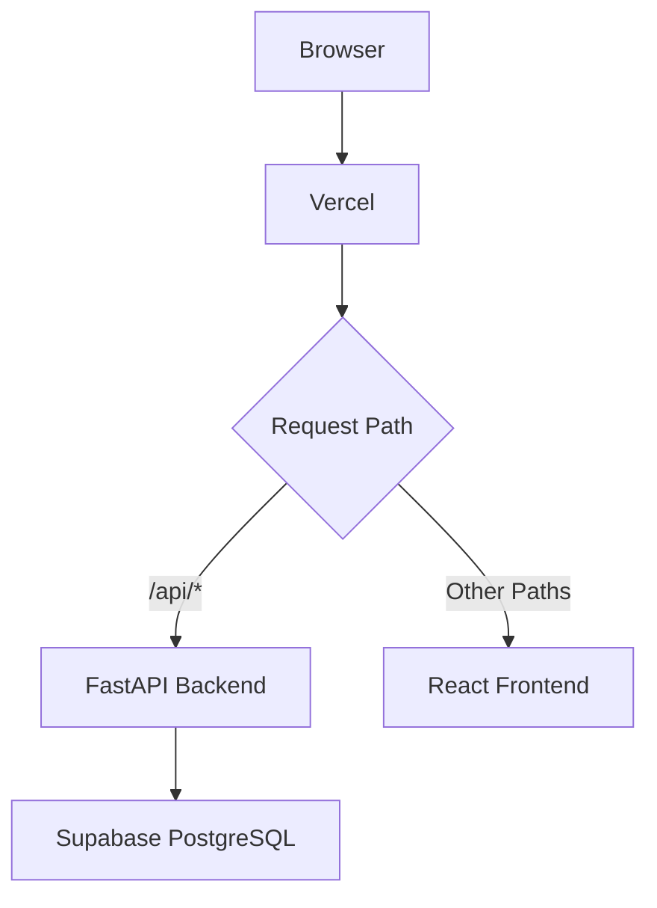

# Independent University, Bangladesh

## CSE309: Web Application & Internet
### Final Project Submission Report

**Project Name:** LibraryNest

**Submitted by:**  
Adiba Rahman Mim  
Student ID: 2311124  
Section: 06  

**Semester:** Autumn 2026  
**Submission Date:** 28 November 2026  

**Submitted to:**  
Sayef Reyadh  
Adjunct Lecturer  
Department of Computer Science and Engineering  
Independent University, Bangladesh  

**Project Repository:** https://github.com/Adi1ba/LibraryNest

**Live Application:** https://2311124.vercel.app/

---

# Table of Contents

- 1. Executive Summary
  - 1.1 Project Overview
  - 1.2 What Was Built Since the Mid Assessment
  - 1.3 Live Links
- Part A. Product Requirements (PRD)
  - A1. Problem Statement
  - A2. Users and Roles
  - A3. Goals and Success Measures
  - A4. Scope and Non-Goals
  - A5. User Stories
- Part B. Software Requirements (SRS)
  - B1. Introduction
  - B2. Functional Requirements
  - B3. Non-Functional Requirements
  - B4. Roles and Permission Matrix
  - B5. Use Cases
  - B6. Acceptance Criteria
  - B7. Traceability Matrix
- Part C. Technical Design (TDD)
  - C1. Technology Stack
  - C2. System Architecture
  - C3. Backend and Frontend Structure
  - C4. Data Model
  - C5. API Design
  - C6. JWT Authentication Design
  - C7. RBAC Design
  - C8. Admin Dashboard Design
  - C9. Security Design and Threats
  - C10. Deployment on Vercel
  - C11. Testing
- Part E. Project Management and Conclusion
  - E1. How to Run and Test
  - E2. GitHub Work
  - E3. Limitations
  - E4. Future Work
  - E5. Sources, Libraries and Tools

---

# 1. Executive Summary

## 1.1 Project Overview

LibraryNest is a web-based library management and reading workspace designed to organize book records, book availability, loan requests, user accounts, and reading groups through a centralized application. The system provides different access levels for students, librarians, and administrators to ensure that users can perform actions according to their assigned roles.

The application combines book management, loan management, JWT-based authentication, Role-Based Access Control (RBAC), user administration, reading group collaboration, and activity logging. The system aims to simplify library operations while providing a structured and secure environment for managing library resources.

## 1.2 What Was Built Since the Mid Assessment

Following the initial Minimum Viable Product (MVP), LibraryNest was extended with the following features:

- Book management and book search.
- Book availability and copy management.
- Loan request, approval, rejection, and return management.
- User registration and login.
- JWT-based authentication with access and refresh tokens.
- Role-Based Access Control for students, librarians, and administrators.
- User management and role management.
- User banning, unbanning, and account activation management.
- Session management and refresh-token revocation.
- User profile and password management.
- Reading groups and group membership management.
- Group-level permissions for reading list operations.
- Admin dashboard and activity audit logging.
- Deployment of the application through Vercel.

## 1.3 Live Links

| Resource | Link |
|---|---|
| GitHub Repository | https://github.com/Adi1ba/LibraryNest |
| Live Application | https://2311124.vercel.app/ |
| API Base | https://2311124.vercel.app/api |
| Swagger API Documentation | https://2311124.vercel.app/api/docs |
| OpenAPI Specification | https://2311124.vercel.app/api/openapi.json |
| Project Video | https://youtu.be/3QaXvkOewAI |

---

# Part A. Product Requirements (PRD)

## A1. Problem Statement

Libraries require an organized system to manage books, book availability, borrowing activities, and user information. Managing these operations through manual records or disconnected systems can make it difficult to track books, monitor loan activities, manage users, and maintain consistent information.

LibraryNest addresses these problems by providing a centralized web application where books and loans can be managed digitally. The system also introduces role-based access control so that students, librarians, and administrators can access only the functionalities permitted to their roles.

The application additionally provides reading groups, group-level permissions, user administration, and activity logging to support collaboration and administrative monitoring.

## A2. Users and Roles

LibraryNest supports three global user roles: Student, Librarian, and Admin.

| Role | Description | Main Responsibilities |
|---|---|---|
| Student | Regular library user | Browse books, search books, view availability, request loans, view personal loan records, participate in reading groups. |
| Librarian | Library operational user | Manage books, review loan requests, approve or reject requests, and process returns. |
| Admin | System administrator | Manage users, roles, account statuses, sessions, dashboard information, and administrative activities. |

### Group-Level Roles

Reading groups additionally use group-level ownership and permission assignments.

| Group Status | Responsibilities |
|---|---|
| Group Owner | Manage group information, members, and group permissions. |
| Group Member | Participate in the group and perform reading-list operations according to assigned permissions. |

Group ownership and membership are separate from the three global system roles.

## A3. Goals and Success Measures

The project aims to achieve the following goals:

| Goal | Success Measure |
|---|---|
| Book Management | Authorized users can create, read, update, and delete book records. |
| Loan Management | Students can submit loan requests and authorized librarians can process them. |
| Authentication | Protected API endpoints require valid authentication. |
| Authorization | Users cannot perform actions outside their assigned permissions. |
| Ownership Protection | Students cannot access other students' private loan records. |
| User Administration | Admins can manage regular user accounts and roles. |
| Reading Groups | Users can participate in groups and perform permitted group operations. |
| Activity Monitoring | Administrative activities can be recorded through audit logs. |
| Deployment | The application is accessible through its deployed web application URL. |

## A4. Scope and Non-Goals

### In-Scope

- User registration and authentication.
- JWT-based authentication.
- Refresh token rotation and session management.
- Role-Based Access Control.
- Book CRUD operations.
- Book searching and availability management.
- Loan request management.
- Loan approval, rejection, and return processing.
- User management.
- Role management.
- User banning and unbanning.
- Reading groups and memberships.
- Group-level permissions.
- Admin dashboard.
- Activity audit logs.
- Web deployment.

### Out-of-Scope

- Online payments.
- Book purchasing and delivery.
- Mobile native applications.
- Real-time chat.
- AI-based book recommendations.
- Integration with external library systems.

### Assumptions and Constraints

- Users access the system through a modern web browser.
- The application requires internet connectivity for the deployed version.
- Database availability depends on the configured database service.
- The application operates within the development and deployment constraints of the semester project.
- Users are expected to follow the permissions assigned to their accounts.
- The project is developed and maintained within the available academic timeframe.

## A5. User Stories

| ID | User Story |
|---|---|
| US-01 | As a user, I want to register an account so that I can access LibraryNest. |
| US-02 | As a user, I want to log in so that I can access my authorized features. |
| US-03 | As a student, I want to search and browse books so that I can find books I need. |
| US-04 | As a student, I want to request a book loan so that I can borrow a book. |
| US-05 | As a student, I want to view my own loan history so that I can track my borrowing activities. |
| US-06 | As a student, I want to join reading groups so that I can participate in collaborative reading activities. |
| US-07 | As a librarian, I want to create, update, and delete book records so that I can maintain the library catalog. |
| US-08 | As a librarian, I want to approve or reject loan requests so that I can manage borrowing activities. |
| US-09 | As a librarian, I want to process returned books so that book availability can be updated. |
| US-10 | As an admin, I want to view and manage user accounts so that I can maintain the system. |
| US-11 | As an admin, I want to assign or update user roles so that users receive appropriate permissions. |
| US-12 | As an admin, I want to ban or unban users so that I can control account access. |

---

# Part B. Software Requirements (SRS)

## B1. Introduction

LibraryNest is a web application developed to support library book management, loan management, user administration, and collaborative reading activities.

The application uses a React and TypeScript frontend, a FastAPI backend, and a PostgreSQL database. The backend provides REST API endpoints that handle authentication, authorization, business logic, and database operations.

### Glossary

| Term | Definition |
|---|---|
| JWT | JSON Web Token used to authenticate requests. |
| Access Token | Short-lived token used to access protected API endpoints. |
| Refresh Token | Token used to obtain a new access token after expiration. |
| RBAC | Role-Based Access Control, which restricts actions based on assigned roles. |
| Audit Log | Record of selected user or administrative activities. |
| Role | Global permission category assigned to a user. |
| Group Permission | Permission assigned to a group member for group-level operations. |

### References

- [RFC 7519 – JSON Web Token](https://datatracker.ietf.org/doc/html/rfc7519)
- [OWASP Application Security Verification Standard](https://owasp.org/www-project-application-security-verification-standard/)
- [FastAPI Documentation](https://fastapi.tiangolo.com/)
- [SQLModel Documentation](https://sqlmodel.tiangolo.com/)
- [React Documentation](https://react.dev/)
- [TypeScript Documentation](https://www.typescriptlang.org/docs/)

## B2. Functional Requirements

### Authentication and Profile Management

| ID | Requirement |
|---|---|
| FR-AUTH-01 | The system shall allow users to register an account. |
| FR-AUTH-02 | The system shall allow registered users to log in using their credentials. |
| FR-AUTH-03 | The system shall hash passwords using Argon2 with a server-side password pepper before storing them. |
| FR-AUTH-04 | The system shall generate access JWTs containing authentication claims and expiration information. |
| FR-AUTH-05 | The system shall support refresh-token-based renewal and refresh-token rotation. |
| FR-AUTH-06 | The system shall support logout and invalidate the associated refresh session. |
| FR-AUTH-07 | The system shall allow authenticated users to view their active session information. |
| FR-AUTH-08 | The system shall allow authenticated users to revoke their own sessions. |
| FR-AUTH-09 | The system shall restrict login attempts and temporarily lock accounts after the configured number of failed attempts. |
| FR-AUTH-10 | The system shall allow users to view and update their profile information. |
| FR-AUTH-11 | The system shall allow authenticated users to change their password after appropriate verification. |

### RBAC and Group Management

| ID | Requirement |
|---|---|
| FR-RBAC-01 | The system shall support the global roles Student, Librarian, and Admin. |
| FR-RBAC-02 | The backend shall authorize protected operations based on user roles and permissions. |
| FR-RBAC-03 | The system shall restrict students from accessing other students' private loan records. |
| FR-RBAC-04 | The system shall allow authenticated users to create reading groups. |
| FR-RBAC-05 | Group owners shall be able to update their group information. |
| FR-RBAC-06 | Group owners shall be able to assign and update group permissions. |
| FR-RBAC-07 | The system shall restrict owner-only operations to the group owner. |
| FR-RBAC-08 | The system shall restrict protected administrative actions involving administrator accounts. |
| FR-RBAC-09 | The system shall reject protected requests from banned users. |

### Admin Management

| ID | Requirement |
|---|---|
| FR-ADM-01 | The system shall provide dashboard statistics for relevant users, books, and loans. |
| FR-ADM-02 | The system shall allow administrators to view, search, and filter user accounts. |
| FR-ADM-03 | The system shall allow administrators to view user details. |
| FR-ADM-04 | The system shall allow administrators to ban and unban regular users. |
| FR-ADM-05 | The system shall allow administrators to update eligible user roles. |
| FR-ADM-06 | The system shall allow administrators to revoke another user's refresh sessions. |
| FR-ADM-07 | The system shall support bulk user management actions. |
| FR-ADM-08 | The system shall allow administrators to view and filter activity audit logs. |
| FR-ADM-09 | The system shall provide administrative visibility into relevant account and security activities through the implemented dashboard and audit functionality. |

### Domain Functional Requirements

| ID | Requirement |
|---|---|
| FR-DOMAIN-01 | The system shall allow authenticated users to browse and view books. |
| FR-DOMAIN-02 | The system shall allow book searching by title, author, and ISBN. |
| FR-DOMAIN-03 | The system shall provide book details and copy availability. |
| FR-DOMAIN-04 | The system shall allow authorized library operators to create, update, and delete book records. |
| FR-DOMAIN-05 | The system shall allow authenticated users to submit loan requests. |
| FR-DOMAIN-06 | The system shall allow authorized librarians to approve or reject loan requests. |
| FR-DOMAIN-07 | The system shall allow authorized librarians to process book returns. |
| FR-DOMAIN-08 | The system shall allow students to view their own loan records and statuses. |
| FR-DOMAIN-09 | The system shall maintain book availability during relevant loan operations. |
| FR-DOMAIN-10 | The system shall support reading-list items within reading groups. |

## B3. Non-Functional Requirements

| ID | Requirement |
|---|---|
| NFR-01 | The system shall store sensitive configuration values in environment variables rather than hardcoding secrets. |
| NFR-02 | The system shall provide a generic authentication failure response where appropriate to avoid unnecessary account information disclosure. |
| NFR-03 | The system shall apply authentication and authorization checks to protected API endpoints. |
| NFR-04 | The system shall support pagination for relevant data retrieval operations and limit page sizes to a maximum of 100 records. |
| NFR-05 | Book search operations should respond within 2 seconds under normal operating conditions. |
| NFR-06 | User and loan API operations should respond within 3 seconds under normal operating conditions. |
| NFR-07 | The frontend shall support responsive layouts for common desktop and mobile browser sizes. |
| NFR-08 | The frontend shall provide loading indicators for relevant asynchronous operations. |
| NFR-09 | The system shall provide understandable error messages for failed API operations. |
| NFR-10 | The database shall preserve stored records across application restarts. |
| NFR-11 | The system shall handle validation and database errors without corrupting stored records. |
| NFR-12 | Authorization logic shall be maintained through centralized and reusable mechanisms where appropriate. |
| NFR-13 | The project shall include automated tests for critical functionality. This requirement is currently not fully met because automated test cases have not yet been implemented. |
| NFR-14 | The backend shall use a modular structure to separate authentication, books, loans, users, groups, and audit functionality. |

## B4. Roles and Permission Matrix

| Operation | Student | Librarian | Admin |
|---|---|---|---|
| Browse books | Yes | Yes | Yes |
| Search books | Yes | Yes | Yes |
| View book details | Yes | Yes | Yes |
| Create books | No | Yes | Yes |
| Update books | No | Yes | Yes |
| Delete books | No | Yes | Yes |
| Submit loan requests | Yes | Authenticated | Authenticated |
| View own loans | Yes | Yes | Yes |
| View all loans | No | Yes | Yes |
| Approve/reject loans | No | Yes | Yes |
| Process returns | No | Yes | Yes |
| Create reading groups | Authenticated | Authenticated | Authenticated |
| View reading groups | Authenticated | Authenticated | Authenticated |
| Update group information | Group owner | Group owner | Group owner |
| Manage group membership | Group owner | Group owner | Group owner |
| Manage group permissions | Group owner | Group owner | Group owner |
| Manage users | No | No | Yes |
| Change user roles | No | No | Yes |
| Ban/unban regular users | No | No | Yes |
| Revoke another user's sessions | No | No | Yes |
| View administrative dashboard | No | No | Yes |
| View audit logs | No | No | Yes |

### Group-Level Permission Matrix

| Group Operation | Permission |
|---|---|
| Create reading-list item | `can_create` |
| Edit reading-list item | `can_edit` |
| Assign group-related permissions | `can_assign` |
| Delete reading-list item | `can_delete` |
| Owner-only group management | Group owner |

Group owners automatically receive full group-level authority. Group members receive permissions according to their membership record.

### Administrative Restrictions

- Administrators cannot change their own role through protected role-management operations.
- Administrators cannot ban another administrator through the protected ban operation.
- Protected administrative actions are restricted to eligible accounts.
- Group ownership does not automatically follow from a global administrator role.

## B5. Use Cases

### UC-01: User Login and Token Renewal

| Field | Description |
|---|---|
| Actor | Student, Librarian, Admin |
| Preconditions | The user has a registered account. |
| Main Flow | The user submits login credentials. The backend verifies the credentials. The backend generates an access token and refresh token. The refresh token is stored in a secure cookie and its hash is stored in the database. |
| Alternate Flow | If credentials are invalid or the account is restricted, the backend rejects the login. |
| Postcondition | An eligible user receives authentication tokens and can access authorized endpoints. |

### UC-02: Create Book

| Field | Description |
|---|---|
| Actor | Librarian or Admin |
| Preconditions | The actor is authenticated and authorized. |
| Main Flow | The actor submits book information. The backend validates the request and creates the book record. |
| Alternate Flow | Invalid input, duplicate ISBN, or unauthorized access causes the request to be rejected. |
| Postcondition | The book record is stored and available through the catalog. |

### UC-03: Manage Group Member Permissions

| Field | Description |
|---|---|
| Actor | Group Owner |
| Preconditions | The actor owns the reading group. |
| Main Flow | The owner selects a member and updates their permission values. The backend verifies ownership and updates the membership record. |
| Alternate Flow | An unauthorized member attempts the operation and is denied. |
| Postcondition | The selected member receives the updated group-level permissions. |

### UC-04: Unauthorized Operation

| Field | Description |
|---|---|
| Actor | Authenticated User |
| Preconditions | The actor is authenticated. |
| Main Flow | The actor attempts an operation outside their role or group permissions. The backend checks the authorization requirements. |
| Alternate Flow | The authorization check fails and the API rejects the request. |
| Postcondition | Unauthorized changes are not applied. |

### UC-05: Ban User

| Field | Description |
|---|---|
| Actor | Admin |
| Preconditions | The admin is authenticated and authorized. |
| Main Flow | The admin selects an eligible user and submits a ban action. The backend updates the account's ban status and revokes applicable refresh sessions. |
| Alternate Flow | The target is another administrator or an invalid target. The action is rejected. |
| Postcondition | An eligible banned user cannot continue using protected endpoints. |

### UC-06: View Audit Log

| Field | Description |
|---|---|
| Actor | Admin |
| Preconditions | The admin is authenticated and authorized. |
| Main Flow | The admin requests audit records. The backend retrieves the available records. |
| Alternate Flow | Unauthorized users cannot access the audit endpoint. |
| Postcondition | The administrator can view available audit records. |

### UC-07: Update Reading Group

| Field | Description |
|---|---|
| Actor | Group Owner |
| Preconditions | The actor owns the reading group. |
| Main Flow | The owner submits updated group information. The backend verifies ownership and updates the group. |
| Alternate Flow | An unauthorized user attempts the operation and is denied. |
| Postcondition | The group information is updated. |

## B6. Acceptance Criteria

| ID | Given | When | Then |
|---|---|---|---|
| AC-01 | A user provides valid registration information | The user submits the registration form | The system creates an account if the registration requirements are satisfied. |
| AC-02 | A registered user provides valid credentials | The user submits the login form | The system authenticates the user and issues authentication tokens. |
| AC-03 | A user provides invalid credentials | The user attempts login | The system rejects the login attempt. |
| AC-04 | A user has reached the configured failed-login threshold | The user continues attempting login | The system applies the configured temporary lockout. |
| AC-05 | An authenticated student requests a book | The student submits a loan request | The system creates a loan request if the operation is valid. |
| AC-06 | A librarian is authenticated | The librarian approves or rejects a loan | The system processes the loan status change if the operation is valid. |
| AC-07 | An authorized librarian processes a return | The return is recorded | The system updates the loan status and relevant book availability. |
| AC-08 | A student has a loan record | The student requests loan history | The system returns the student's permitted loan records. |
| AC-09 | A student attempts to access another student's private loan record | The student sends the API request | The system denies access and does not expose the other student's data. |
| AC-10 | A librarian or admin is authenticated | The user creates a book | The system validates and stores the book record. |
| AC-11 | A book has active loan references | An authorized user attempts to delete it | The system prevents unsafe deletion and returns an appropriate error. |
| AC-12 | A group owner is authenticated | The owner updates group permissions | The system updates the membership permissions. |
| AC-13 | A group member lacks a required permission | The member attempts a restricted group operation | The system returns 403 Forbidden. |
| AC-14 | An unauthorized user attempts an admin endpoint | The user sends the request | The system denies access. |
| AC-15 | An admin attempts to change their own role | The admin submits the role update | The system rejects the protected operation. |
| AC-16 | An admin attempts to ban another admin | The admin submits the ban request | The system rejects the action and the target remains unbanned. |
| AC-17 | An admin bans an eligible regular user | The ban operation is processed | The system updates the ban status and revokes applicable refresh sessions. |
| AC-18 | A banned user possesses an access token | The banned user sends a protected request | The system rejects the request. |
| AC-19 | An admin requests dashboard statistics | The admin sends an authorized request | The system returns available dashboard statistics. |
| AC-20 | An admin requests audit records | The admin sends an authorized request | The system returns available audit records. |
| AC-21 | A user updates their profile | The user submits valid profile information | The system updates the profile. |
| AC-22 | A user changes their password | The user submits valid verification and password information | The system processes the password change. |
| AC-23 | A user requests their sessions | The user sends an authenticated request | The system returns their permitted session information. |
| AC-24 | A user revokes an eligible session | The user submits a session-revocation request | The system revokes the selected session. |
| AC-25 | An access token has expired | The user sends a request to a protected API endpoint | The API returns 401 Unauthorized. |
| AC-26 | An access token has been tampered with | The user sends the token to a protected API endpoint | The API rejects the token and returns 401 Unauthorized. |
| AC-27 | A student attempts to read another student's loan record | The student requests another user's private loan data | The system denies the request and does not expose the record. |
| AC-28 | A group member lacks permission for a restricted action | The member attempts the restricted operation | The API returns 403 Forbidden. |
| AC-29 | A user has been banned | The banned user sends another protected request | The API rejects the request with 401 Unauthorized. |
| AC-30 | An admin attempts to ban another administrator | The admin sends the ban request | The system rejects the action, the target remains unbanned, and the action may be recorded in the audit log according to the implemented logging behavior. |

### Acceptance Criteria Verification Status

Automated verification of these acceptance criteria has not yet been implemented. The criteria describe the intended behavior of the system and the tests that should be developed for future verification.

## B7. Traceability Matrix

| Requirement ID | API / Component | Verification Status |
|---|---|---|
| FR-AUTH-01 | POST `/api/auth/register` | Not implemented as automated test |
| FR-AUTH-02 | POST `/api/auth/login` | Not implemented as automated test |
| FR-AUTH-04 | Protected API authentication | Not implemented as automated test |
| FR-AUTH-05 | POST `/api/auth/refresh` | Not implemented as automated test |
| FR-AUTH-06 | POST `/api/auth/logout` | Not implemented as automated test |
| FR-AUTH-07 | GET `/api/auth/me/sessions` | Not implemented as automated test |
| FR-AUTH-08 | Session revocation endpoints | Not implemented as automated test |
| FR-AUTH-09 | Login lockout mechanism | Not implemented as automated test |
| FR-AUTH-10 | GET/PATCH `/api/auth/me` | Not implemented as automated test |
| FR-AUTH-11 | POST `/api/auth/change-password` | Not implemented as automated test |
| FR-RBAC-02 | Protected backend endpoints | Not implemented as automated test |
| FR-RBAC-03 | Loan ownership validation | Not implemented as automated test |
| FR-RBAC-06 | Group permission management | Not implemented as automated test |
| FR-RBAC-07 | Group owner-only operations | Not implemented as automated test |
| FR-RBAC-09 | Protected request validation for banned users | Not implemented as automated test |
| FR-ADM-01 | GET `/api/users/admin/dashboard-stats` | Not implemented as automated test |
| FR-ADM-02 | GET `/api/users/` | Not implemented as automated test |
| FR-ADM-03 | GET `/api/users/{user_id}` | Not implemented as automated test |
| FR-ADM-04 | Ban/unban user endpoints | Not implemented as automated test |
| FR-ADM-05 | PATCH `/api/users/{user_id}/role` | Not implemented as automated test |
| FR-ADM-06 | Session revocation for users | Not implemented as automated test |
| FR-ADM-08 | GET `/api/audit/` | Not implemented as automated test |
| FR-DOMAIN-01 | GET `/api/books/` | Not implemented as automated test |
| FR-DOMAIN-02 | Book search | Not implemented as automated test |
| FR-DOMAIN-03 | GET `/api/books/{book_id}` | Not implemented as automated test |
| FR-DOMAIN-04 | Book CRUD endpoints | Not implemented as automated test |
| FR-DOMAIN-05 | POST `/api/loans/` | Not implemented as automated test |
| FR-DOMAIN-06 | Loan approval/rejection endpoint | Not implemented as automated test |
| FR-DOMAIN-07 | Loan return processing | Not implemented as automated test |
| FR-DOMAIN-08 | Student loan history | Not implemented as automated test |
| FR-DOMAIN-09 | Book availability management | Not implemented as automated test |
| FR-DOMAIN-10 | Group reading-list endpoints | Not implemented as automated test |

---

# Part C. Technical Design (TDD)

## C1. Technology Stack

| Component | Technology | Purpose |
|---|---|---|
| Frontend | React | User interface development. |
| Frontend Language | TypeScript | Type-safe frontend development. |
| Frontend Build Tool | Vite | Development and frontend build tooling. |
| Styling | CSS | Frontend styling and layout. |
| Backend | FastAPI | REST API development. |
| Backend Language | Python | Backend application logic. |
| ORM | SQLModel and SQLAlchemy | Database models and database operations. |
| Database | PostgreSQL | Persistent application data storage. |
| Database Hosting | Supabase | Hosted PostgreSQL database. |
| Database Migration | Alembic | Database schema migration management. |
| Authentication | JWT | Access-token authentication. |
| Password Security | pwdlib / Argon2 | Password hashing. |
| API Documentation | Swagger UI / OpenAPI | API documentation and endpoint exploration. |
| Testing Setup | Pytest and HTTPX | Automated test tooling; test cases are not yet implemented. |
| Version Control | Git and GitHub | Source code management. |
| Deployment | Vercel | Web application deployment. |
| Development Environment | Visual Studio Code | Code editing and project development. |

## C2. System Architecture

LibraryNest uses a frontend-backend architecture. The frontend communicates with the FastAPI backend through REST API requests. The backend performs authentication, authorization, business logic, validation, and database operations using SQLModel and SQLAlchemy.

The PostgreSQL database is hosted through Supabase. Vercel is used to deploy the application using the root deployment configuration.

### Architecture Diagram



### Authentication Flow Overview



## C3. Backend and Frontend Structure

### Backend Structure

```text
backend/
├── main.py
├── requirements.txt
└── app/
    ├── config.py
    ├── database.py
    ├── auth/
    │   ├── models.py
    │   ├── schemas.py
    │   ├── router.py
    │   ├── service.py
    │   ├── security.py
    │   ├── dependencies.py
    │   └── permissions.py
    ├── books/
    │   ├── models.py
    │   ├── schemas.py
    │   ├── router.py
    │   ├── service.py
    │   └── repository.py
    ├── loans/
    │   ├── models.py
    │   ├── schemas.py
    │   ├── router.py
    │   ├── service.py
    │   └── repository.py
    ├── users/
    │   ├── router.py
    │   └── service.py
    ├── groups/
    │   ├── router.py
    │   ├── service.py
    │   ├── models.py
    │   └── schemas.py
    └── audit/
        ├── router.py
        ├── service.py
        ├── models.py
        └── schemas.py
```

### Frontend Structure

```text
frontend/
├── public/
├── src/
│   ├── App.tsx
│   ├── main.tsx
│   ├── index.css
│   ├── pages/
│   │   ├── BooksPage
│   │   ├── LoansPage
│   │   ├── LoginPage
│   │   ├── RegisterPage
│   │   ├── ProfilePage
│   │   ├── GroupsPage
│   │   ├── AdminDashboardPage
│   │   └── UserManagementPage
│   ├── services/
│   │   ├── authService
│   │   ├── bookService
│   │   ├── loanService
│   │   ├── userService
│   │   ├── groupService
│   │   └── auditService
│   └── types/
│       ├── auth.ts
│       ├── book.ts
│       └── loan.ts
└── package.json
```

The frontend pages provide the user-facing interface, while the service modules handle API communication. The backend modules separate authentication, book operations, loans, user management, groups, and audit logging.

## C4. Data Model

The application uses PostgreSQL to store user accounts, book records, loan records, reading groups, group memberships, refresh sessions, and audit logs.

### User

| Field | Description |
|---|---|
| id | Primary key |
| first_name | User's first name |
| last_name | User's last name |
| email | Unique email address |
| password_hash | Hashed password |
| role | Global user role; default Student |
| is_active | Account activation status |
| is_banned | Ban status |
| ban_reason | Optional ban reason |
| failed_login_attempts | Failed login count |
| locked_until | Optional temporary lockout expiry |
| created_at | Account creation timestamp |

### RefreshSession

| Field | Description |
|---|---|
| id | Primary key |
| user_id | Foreign key to User |
| token_hash | Unique hashed refresh token |
| expires_at | Refresh token expiration |
| revoked_at | Optional revocation timestamp |
| created_at | Session creation timestamp |
| last_used_at | Optional last-use timestamp |

### Book

| Field | Description |
|---|---|
| id | Primary key |
| title | Book title |
| author | Author |
| isbn | Unique ISBN |
| total_copies | Total book copies |
| available_copies | Available copies |
| created_at | Creation timestamp |
| updated_at | Last update timestamp |

### Loan

| Field | Description |
|---|---|
| id | Primary key |
| book_id | Foreign key to Book |
| user_id | Optional foreign key to User |
| student_name | Student name associated with the loan |
| student_email | Student email associated with the loan |
| status | Loan status |
| requested_at | Request timestamp |
| returned_at | Optional return timestamp |

### ReadingGroup

| Field | Description |
|---|---|
| id | Primary key |
| name | Group name |
| description | Optional group description |
| owner_id | Foreign key to User |
| created_at | Creation timestamp |

### GroupMembership

| Field | Description |
|---|---|
| id | Primary key |
| group_id | Foreign key to ReadingGroup |
| user_id | Foreign key to User |
| can_create | Create permission |
| can_edit | Edit permission |
| can_assign | Permission assignment capability |
| can_delete | Delete permission |
| joined_at | Membership timestamp |
| Constraint | Unique group_id and user_id combination |

### AuditLog

| Field | Description |
|---|---|
| id | Primary key |
| actor_user_id | Optional actor user ID |
| actor_email | Optional actor email |
| target_user_id | Optional target user ID |
| target_email | Optional target email |
| event_type | Activity type |
| description | Activity description |
| ip_address | Optional IP address |
| user_agent | Optional user-agent information |
| outcome | Operation outcome |
| created_at | Activity timestamp |

### Entity Relationship Diagram



## C5. API Design

The backend exposes REST API endpoints under the `/api` prefix.

### Authentication APIs

| Method | Endpoint | Access | Purpose |
|---|---|---|---|
| POST | `/api/auth/register` | Public | Register a user. |
| POST | `/api/auth/login` | Public | Authenticate a user. |
| POST | `/api/auth/refresh` | Refresh cookie | Refresh tokens and rotate the refresh token. |
| POST | `/api/auth/logout` | Authenticated / session cookie | Logout and invalidate session. |
| GET | `/api/auth/me` | Bearer token | Retrieve current user. |
| PATCH | `/api/auth/me` | Bearer token | Update current profile. |
| GET | `/api/auth/me/sessions` | Bearer token | Retrieve own sessions. |
| DELETE | `/api/auth/me/sessions/{session_id}` | Bearer token | Revoke own session. |
| POST | `/api/auth/change-password` | Bearer token | Change password. |

### Book APIs

| Method | Endpoint | Access | Purpose |
|---|---|---|---|
| POST | `/api/books/` | Librarian/Admin | Create a book. |
| GET | `/api/books/` | Authenticated | List and search books. |
| GET | `/api/books/{book_id}` | Authenticated | Retrieve book details. |
| PUT | `/api/books/{book_id}` | Librarian/Admin | Update a book. |
| DELETE | `/api/books/{book_id}` | Librarian/Admin | Delete a book. |

### Loan APIs

| Method | Endpoint | Access | Purpose |
|---|---|---|---|
| POST | `/api/loans/` | Authenticated | Create a loan request. |
| GET | `/api/loans/` | Student: own / Librarian/Admin: all | Retrieve loan records. |
| GET | `/api/loans/{loan_id}` | Student: own / Librarian/Admin | Retrieve loan details. |
| PATCH | `/api/loans/{loan_id}/status` | Librarian/Admin | Update loan status. |

### User APIs

| Method | Endpoint | Access | Purpose |
|---|---|---|---|
| GET | `/api/users/` | Admin | Retrieve users. |
| GET | `/api/users/admin/dashboard-stats` | Admin | Retrieve dashboard statistics. |
| GET | `/api/users/{user_id}` | Admin | Retrieve user details. |
| PATCH | `/api/users/{user_id}/role` | Admin | Update user role. |
| POST | User ban endpoint | Admin | Ban an eligible user. |
| PATCH | User unban endpoint | Admin | Unban an eligible user. |
| POST | `/api/users/bulk-action` | Admin | Perform bulk user actions. |
| POST | User session revocation endpoint | Admin | Revoke another user's sessions. |
| PATCH | User activation/deactivation endpoint | Admin | Update account activation status. |

### Group APIs

| Method | Endpoint | Access | Purpose |
|---|---|---|---|
| POST | `/api/groups` | Authenticated | Create a reading group. |
| GET | `/api/groups` | Authenticated | List accessible groups. |
| GET | `/api/groups/{id}` | Authenticated | Retrieve group details. |
| PATCH | `/api/groups/{id}` | Owner | Update group information. |
| DELETE | `/api/groups/{id}` | Owner | Delete group. |
| GET | Group members endpoint | Authenticated | View group membership. |
| POST | Group members endpoint | Owner | Add a member. |
| PATCH | Group permissions endpoint | Owner | Update member permissions. |
| DELETE | Group member endpoint | Owner | Remove a member. |
| GET | Group reading-list endpoint | Authenticated | View reading list. |
| POST | Group reading-list endpoint | Permitted member | Create a reading-list item. |
| PATCH | Group reading-list endpoint | Permitted member | Edit a reading-list item. |
| DELETE | Group reading-list endpoint | Permitted member | Delete a reading-list item. |

## C6. JWT Authentication Design

LibraryNest uses JWT-based authentication to authenticate users and protect backend API endpoints.

### Authentication Components

- Access token: A short-lived JWT used for protected API requests.
- Refresh token: A longer-lived token used to obtain a new authentication token pair.
- RefreshSession: Database record used to maintain and revoke refresh sessions.
- Authorization header: Used to send access tokens to protected endpoints.
- Refresh cookie: Used to submit refresh tokens to the refresh endpoint.

### JWT Claims

| Claim | Purpose |
|---|---|
| sub | User identity |
| role | User's role |
| iat | Token issued-at timestamp |
| exp | Token expiration timestamp |

### Token Configuration

| Token | Default Lifetime | Storage / Handling |
|---|---|---|
| Access Token | 15 minutes | Stored in browser localStorage and sent through the Authorization Bearer header. |
| Refresh Token | 7 days | Sent through an HttpOnly cookie; its hash is stored in the database. |

### Authentication Sequence



### Refresh Token Flow



### Token Security

- Access tokens are signed using HS256.
- Tokens contain expiration information.
- The backend verifies token signatures and expiration.
- The backend verifies the user account status.
- The backend verifies the user's current role against database information.
- Refresh tokens are stored as SHA-256 hashes in the database.
- Refresh token rotation is implemented.
- Refresh cookies are HttpOnly.
- Refresh cookies use SameSite=Lax.
- Secure cookie behavior is enabled in the Vercel deployment configuration.
- Logout and session-revocation operations invalidate refresh sessions.

The implemented frontend refresh retry behavior is present in the group service. It should not be assumed that every frontend service automatically retries requests after token expiration.

## C7. RBAC Design

LibraryNest uses Role-Based Access Control to restrict API operations according to the user's global role and, where applicable, group-level permissions.

### Global Roles

| Role | Access |
|---|---|
| Student | Book browsing, loan requests, own loans, and permitted reading group activities. |
| Librarian | Book and loan management operations. |
| Admin | Administrative user management, dashboard, and related protected operations. |

### Authorization Process

1. The frontend sends a request to a protected endpoint.
2. The backend verifies the access token.
3. The backend retrieves and verifies the authenticated user.
4. The backend checks account activation and ban status.
5. The backend verifies role requirements.
6. Where necessary, the backend checks resource ownership or group permissions.
7. The backend executes the operation only if authorization requirements are satisfied.

### RBAC Flow Diagram



### Group-Level Permissions

Reading group members may have the following permissions:

- `can_create`
- `can_edit`
- `can_assign`
- `can_delete`

Group owners have all group permissions. Other members must have the appropriate permission for the operation.

### Admin Restrictions

- Admin role checks are performed by protected backend operations.
- An admin cannot change their own role through the protected role update operation.
- An admin cannot ban another admin through the protected ban operation.
- Administrative operations involving eligible users are restricted to admin accounts.
- Admin access does not automatically grant group ownership.

## C8. Admin Dashboard Design

The admin dashboard provides administrative access to relevant system information and user management operations.

| Component | Description |
|---|---|
| Dashboard Statistics | Displays available statistics related to users, books, and loans. |
| User Management | Allows administrators to view and manage user accounts. |
| User Details | Provides relevant user information. |
| Role Management | Allows administrators to update eligible user roles. |
| Account Activation | Supports account activation and deactivation. |
| Ban Management | Supports banning and unbanning eligible users. |
| Bulk User Actions | Supports administrative bulk operations. |
| Session Management | Supports revoking refresh sessions. |
| Audit Logs | Provides access to recorded activity information. |

The dashboard uses protected API endpoints and is restricted to administrator access.

## C9. Security Design and Threats

| Threat | Mitigation |
|---|---|
| Password disclosure | Passwords are hashed using Argon2 with a server-side pepper. |
| Stolen access token | Access token expiration is limited; protected endpoints validate token signatures and expiration. |
| Stolen refresh token | Refresh token hashes are stored in the database; refresh token rotation and session revocation are supported. |
| Brute-force login | Failed login attempts are counted and temporary account lockout is applied after the configured threshold. |
| Privilege escalation | Protected endpoints use role and permission checks. |
| Unauthorized loan access | Loan ownership checks restrict student access to their own records. |
| Banned user access | User status is checked on protected requests; banned accounts are rejected. |
| XSS | React's default escaping helps reduce injection risk; storing access tokens in localStorage remains a risk if XSS occurs. |
| CSRF | Refresh cookies use SameSite=Lax and an appropriate cookie path; CORS is configured. Explicit CSRF token and Origin/Referer validation are not confirmed as implemented. |
| Secret exposure | Sensitive configuration values are supplied through environment variables. |
| SQL injection | SQLModel and SQLAlchemy parameterized database operations are used. |
| Invalid input | Request schemas and backend validation are used for relevant API operations. |
| Administrative misuse | Protected admin endpoints enforce administrator authorization and restrictions on sensitive actions. |

## C10. Deployment on Vercel

LibraryNest is deployed through Vercel using the root `vercel.json` deployment configuration.

### Deployment Structure

- Frontend source directory: `frontend`
- Backend source directory: `backend`
- Backend application entry point: `main:app`
- Frontend build: `npm run build`
- Backend API prefix: `/api`
- Database: PostgreSQL hosted through Supabase.

### Deployment Routing

The root deployment configuration routes API requests to the FastAPI backend and other web requests to the frontend.



### Environment Variables

The application uses the following configuration variables where applicable:

| Variable | Purpose |
|---|---|
| DATABASE_URL | Database connection configuration. |
| POSTGRES_URL | PostgreSQL connection configuration where used. |
| JWT_SECRET_KEY | JWT signing secret. |
| PASSWORD_PEPPER | Password hashing pepper. |
| JWT_ACCESS_TOKEN_EXPIRE_MINUTES | Access token lifetime configuration. |
| JWT_REFRESH_TOKEN_EXPIRE_DAYS | Refresh token lifetime configuration. |
| VERCEL | Deployment environment indicator. |

Sensitive values are not included in this report.

### Local Development Routing

The frontend development server uses a Vite configuration to communicate with the backend during local development. The local backend runs through Uvicorn, while the frontend runs through the Vite development server.

## C11. Testing

### Testing Tools

| Tool | Purpose |
|---|---|
| Pytest | Python automated testing framework. |
| HTTPX | HTTP client used with API testing tools. |

Pytest and HTTPX were installed in the local backend development environment.

### Current Testing Status

- Pytest was installed in the development environment.
- The `backend/tests/` directory did not contain implemented test cases when checked.
- Running `pytest -v` resulted in zero collected tests.
- Automated testing of the critical acceptance criteria has not yet been completed.

### Planned Test Cases

| Test ID | Scenario | Expected Result |
|---|---|---|
| TEST-01 | Access token expiration | Protected endpoint returns 401. |
| TEST-02 | Tampered access token | Token is rejected with 401. |
| TEST-03 | Student accesses another student's loan | Access is denied and private data is not exposed. |
| TEST-04 | Group member attempts an action without permission | API returns 403. |
| TEST-05 | Banned user sends a protected request | API rejects the request with 401. |
| TEST-06 | Admin attempts to ban another admin | Action is rejected and target remains unbanned. |
| TEST-07 | Invalid login attempts | Temporary lockout is applied after the configured threshold. |
| TEST-08 | Refresh token rotation | Old session is invalidated and the new session is created. |
| TEST-09 | Unauthorized user accesses admin endpoint | API rejects the request. |
| TEST-10 | Student requests another user's loan information | Ownership protection denies the request. |

These test cases are planned verification scenarios and have not been reported as executed automated tests.

---

# Part E. Project Management and Conclusion

## E1. How to Run and Test

### Prerequisites

- Python 3.11
- Node.js and npm
- Git
- Visual Studio Code or another code editor
- Supabase PostgreSQL or a local database configuration

### Clone the Repository

```bash
git clone https://github.com/Adi1ba/LibraryNest.git
cd LibraryNest
```

### Backend Setup

Create a virtual environment:

```powershell
python -m venv venv
.\venv\Scripts\Activate.ps1
```

Install backend dependencies:

```powershell
cd backend
..\venv\Scripts\python.exe -m pip install -r requirements.txt
```

### Environment Configuration

Create a `.env` file in the backend configuration location and supply the required environment variables.

Example configuration:

```env
DATABASE_URL=sqlite:///./library_nest.db
JWT_SECRET_KEY=replace_with_a_secure_secret
PASSWORD_PEPPER=replace_with_a_different_secure_secret
JWT_ACCESS_TOKEN_EXPIRE_MINUTES=15
JWT_REFRESH_TOKEN_EXPIRE_DAYS=7
VERCEL=false
```

The example above is intended for local development. Production configuration should use the appropriate PostgreSQL database and secure environment variables.

### Database Migration

Run the database migrations:

```bash
alembic upgrade head
```

### Run Backend

```bash
uvicorn main:app --reload
```

Backend API documentation:

```text
http://127.0.0.1:8000/api/docs
```

### Frontend Setup

Open a separate terminal:

```bash
cd frontend
npm install
npm run dev
```

The frontend development server is available at:

```text
http://localhost:5173
```

### Testing Setup

Install the testing dependencies if they are not already installed:

```bash
pip install pytest httpx
```

From the backend directory, run:

```bash
python -m pytest -v
```

The current repository does not yet contain implemented automated test cases. Therefore, the command currently collects zero tests.

### Manual Verification Checklist

- Open the frontend application.
- Register a user.
- Log in.
- Browse and search books.
- View book details and availability.
- Submit a loan request.
- Review loan operations using an eligible account.
- Check profile management.
- Check reading group operations.
- Check administrative features using an eligible administrator account.
- Verify restricted operations using accounts with different roles.

These steps describe a manual verification procedure and are not presented as a completed testing record.

## E2. GitHub Work

The project was developed using GitHub issues, branches, and pull requests to organize feature development and documentation updates.

| Issue / PR | Work |
|---|---|
| #13 / #14 | Loan Request Management |
| #15 / #16 | Backend Authentication JWT |
| #17 / #18 | Frontend Authentication |
| #19 / #20 | Backend RBAC and User Management |
| #21 / #22 | JWT Authorization for Book and Loan APIs |
| #23 / #24 | Frontend RBAC and User Management |
| #25 / #26 | JWT Refresh Tokens and Server-side Sessions |
| #27 / #28 | Profile and Password Management |
| #29 / #30 | Group Reading Workspace and Permissions |
| #31 / #32 | Admin Dashboard and User Management |
| #33 / #34 | Admin Activity and Audit Logs |
| #35 / #36 | Group Deletion, Session Management, and Login Protection |
| #37 / #38 | Project Documentation |
| #39 / #40 | Book Deletion Error Handling |
| #41 / #42 | SRS Corrections |

The project was developed iteratively. Features were organized into GitHub issues, implemented through branches, and incorporated into the main project through pull requests. The development process included application features, authentication, authorization, user management, group functionality, security-related functionality, and documentation improvements.

Repository: https://github.com/Adi1ba/LibraryNest

## E3. Limitations

### 1. Automated Testing

Pytest and HTTPX were installed in the development environment; however, automated test cases have not yet been implemented. Running pytest resulted in zero collected tests. Future development should include automated verification of authentication, token expiration, RBAC, resource ownership, and administrative restrictions.

### 2. Access Token Storage

Access tokens are currently stored in localStorage. Although protected endpoints validate tokens, localStorage may expose tokens if the application experiences an XSS vulnerability. Future improvements may include alternative token-storage strategies and additional XSS protection.

### 3. Book Deletion Handling

Book records with active references may not be safely deleted due to database constraints. The application handles relevant deletion errors, but additional user-friendly error messages and an archival approach could improve the experience.

### 4. Audit Logging Coverage

Audit logging is implemented for relevant activities, but logging coverage may not include every operation or security event. Additional coverage could improve administrative monitoring.

## E4. Future Work

- Implement automated tests for authentication, authorization, and domain operations.
- Add automated tests for JWT expiration and tampered tokens.
- Expand test coverage for RBAC and resource ownership.
- Improve token-storage security and XSS mitigation.
- Improve book deletion handling and consider book archival.
- Expand audit logging coverage.
- Improve monitoring of suspicious account activities.
- Optimize API performance.
- Improve database backup and recovery procedures.
- Improve validation and user feedback.
- Improve frontend navigation and user experience.

## E5. Sources, Libraries and Tools

| Source / Tool | Purpose |
|---|---|
| React | Frontend interface development. |
| TypeScript | Type-safe frontend development. |
| Vite | Frontend development and build tooling. |
| FastAPI | Backend REST API development. |
| Python | Backend programming language. |
| SQLModel | Database models and ORM integration. |
| SQLAlchemy | Database access and ORM functionality. |
| PostgreSQL | Relational database. |
| Supabase | Hosted PostgreSQL database. |
| Alembic | Database migration management. |
| pwdlib / Argon2 | Password hashing. |
| PyJWT | JWT-based authentication. |
| Pytest | Automated testing framework; test cases are not yet implemented. |
| HTTPX | HTTP client used with testing tools. |
| Git | Version control. |
| GitHub | Repository hosting, issue tracking, and pull request workflow. |
| Visual Studio Code | Development environment. |
| Vercel | Application deployment. |
| Swagger UI / OpenAPI | API documentation and API exploration. |
| ChatGPT (OpenAI) | Used for code explanations, debugging assistance, understanding authentication and RBAC concepts, and documentation assistance. Suggestions were reviewed and adapted during project development. |

---

**End of Report**